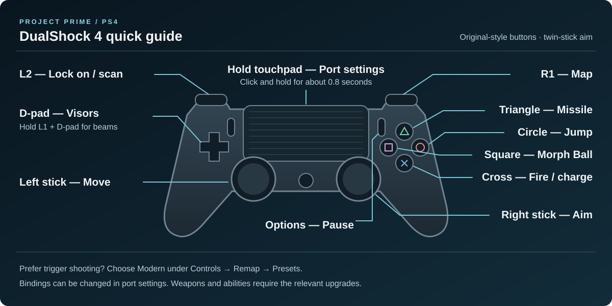

# Metroid Prime for PS4 — Project Prime

This is my native PS4 port of the original GameCube **Metroid Prime**. Pick up a
DualShock 4 and explore Tallon IV in widescreen HD, with PlayStation button
prompts, rumble and proper saves.

The game engine runs directly on the PS4, with native graphics, audio and
controller support. I've been playing and testing it on a PS4 Slim. The PKG is
roughly **80 MB**; you add your own game image separately.

## What's included

- **1920×1080 rendering in Auto mode and a widescreen HUD**, with adjustable
  graphics and display settings.
- **DualShock 4 controls and vibration**, with twin-stick aiming, original-style
  buttons and remapping.
- **PlayStation button prompts** throughout the game.
- **Fullscreen menus**, with smoother sampling of the original movie backgrounds.
- **A 3D PS4 in the Options screen**, with the menu's existing lighting and animation.
- **Persistent saves and settings** that stay in place when updating the application.
- **Renderer and loading improvements**, with shader caching, less CPU draw setup
  and fewer repeated shader-constant uploads.
- A controller-accessible settings panel for aim sensitivity, deadzones, inversion
  and other port options. No keyboard required.



## Download — Release Candidate 7

**One MediaFire ZIP**, `Project-Prime-PS4-00.50-RC7.zip`, includes the PS4 PKG, ready-to-run Windows GamePrep helper,
controls and short setup instructions. The download link is coming with the upload.

RC7 adds collision reuse to Dawn’s bounded bind-group usage cache, retaining
the same 64-reference limit and resource tracking. It keeps the earlier
presentation, model, control and startup fixes. Host and native checks pass;
the new cache’s PS4 performance comparison is pending.
In matched v49 console tests, the presentation change reduced Fiery Shores’
p95 frame time from 28.8 to 18.6 ms. Heavy Main Plaza views still ran around
40–42 FPS. A locked 1080p60 and a complete playthrough have not been verified.
Please include the room and what you were doing when reporting a problem.

## Getting it running

You'll need a homebrew-enabled PS4 that can install unsigned PKGs and your own
original GameCube Metroid Prime image.

Unpack the download once: the application is in `PS4/`, and the PC helper is
`GamePrep/GamePrep.exe`.

1. **Prepare `MetroidPrime.iso` on your PC.** A raw ISO or GCM can be named
   `MetroidPrime.iso` directly. For an RVZ or ZIP, open the included
   `GamePrep/GamePrep.exe`, or drag your file onto the EXE. It converts and checks
   the image, then puts `MetroidPrime.iso` in a new `ProjectPrimeData` folder next
   to your input. No Python installation is needed.
2. **Install the PKG**, then copy the ISO by FTP to the exact path below. Create
   the folders if needed and wait for the transfer to finish.

   ```text
   /data/project-prime/data/MetroidPrime.iso
   ```

3. **Launch from the PS4 home screen.** FTP doesn't need to stay connected.

GamePrep doesn't download the game. Renaming an RVZ to ISO doesn't convert it.
Wii Trilogy and Switch images aren't supported. See the [installation guide](docs/INSTALLING.md)
for accepted versions, conversion and updates.

## Controls and saves

**Options** pauses the game. **Hold the touchpad button for about 0.8 seconds**
to open or close the port settings. The [controls guide](docs/CONTROLS.md)
covers the layouts, beam and visor selection.

Save at the game's save stations. Saves and settings live in
`/data/project-prime/release/user/`; back up that folder and keep it when updating
or clearing caches.

## Source and credits

The PS4 backend, tools, tests and integration patches are here. See
[source and building](docs/SOURCE.md) for the code layout and pinned dependencies.

Built on [MetroidPrimePort](https://github.com/timehikari/metroidprimeport),
Aurora and MusyX, [Dawn](https://github.com/google/dawn),
[SDL](https://github.com/libsdl-org/SDL), and
[orbis-ports Mesa](https://github.com/orbis-ports/mesa-ps4).
Original game and third-party work retain their own notices. This is an
unofficial homebrew port.
