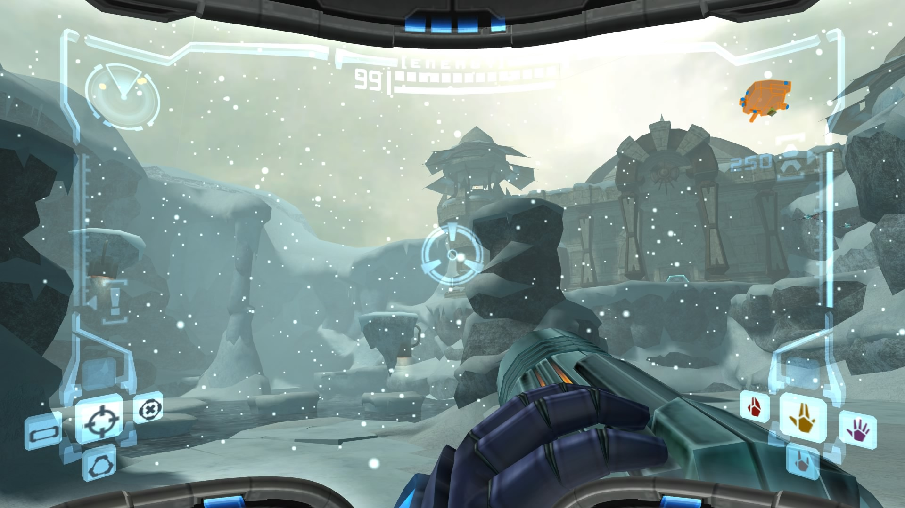
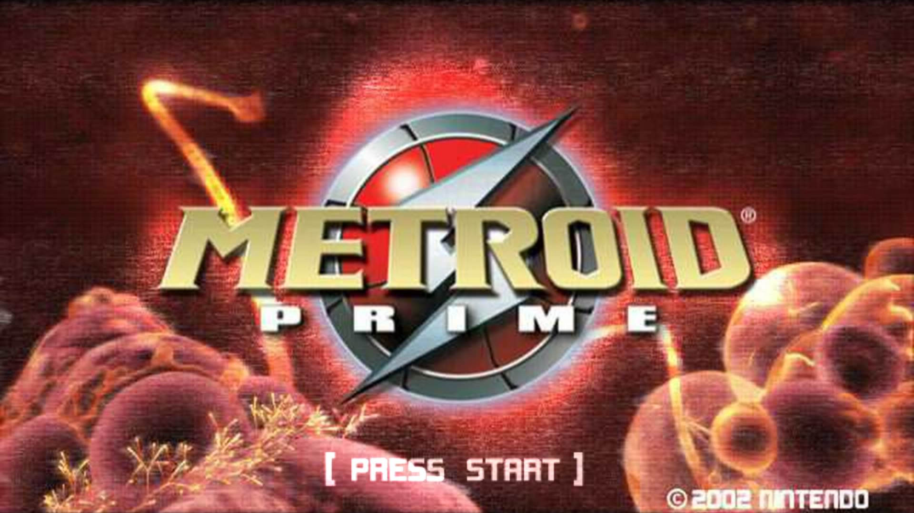
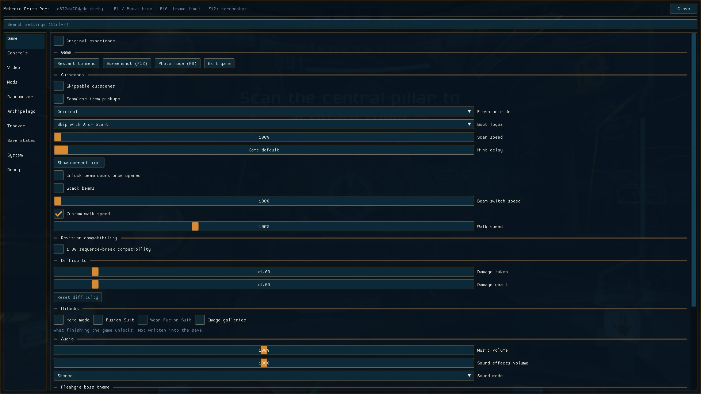
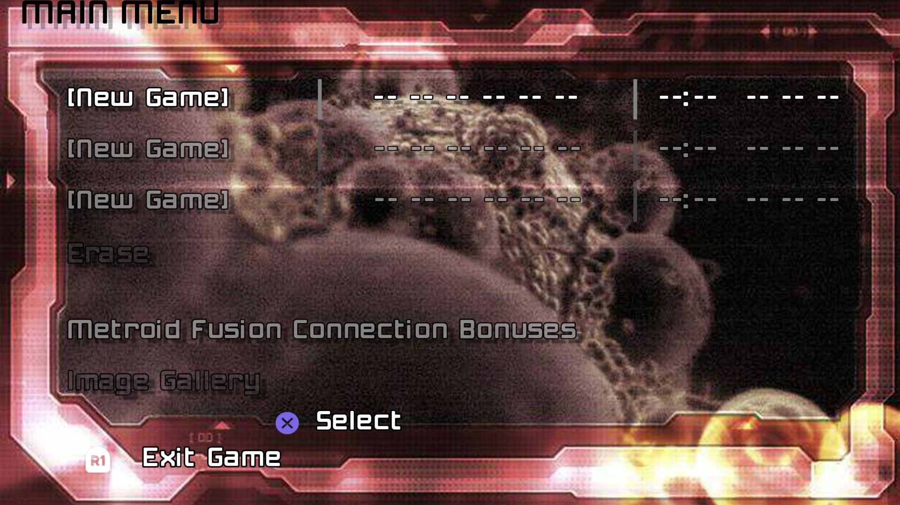
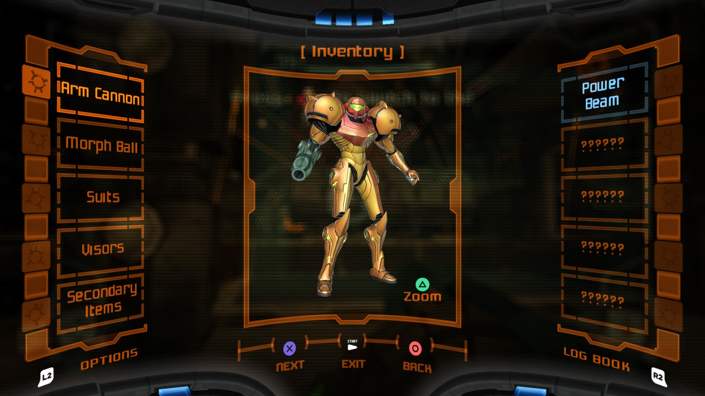
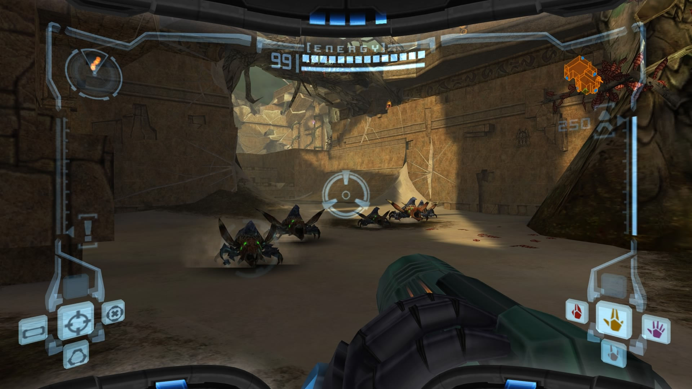
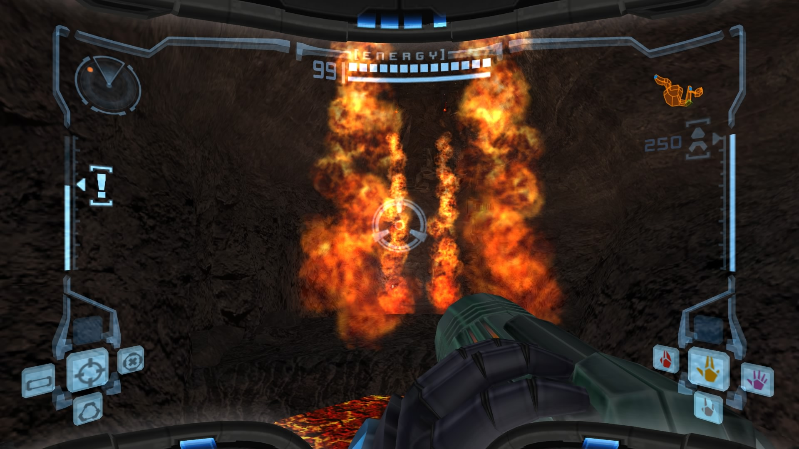
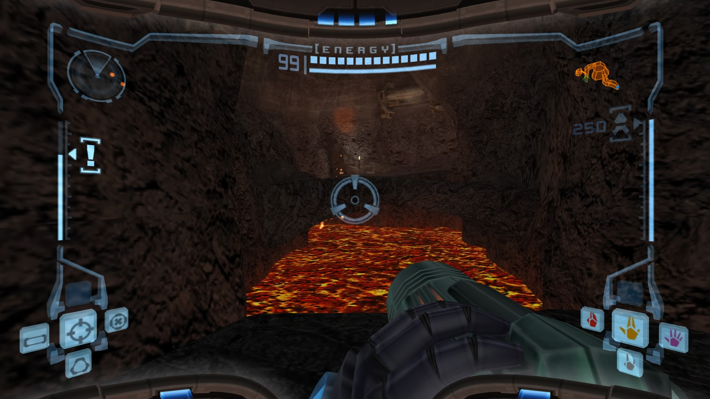
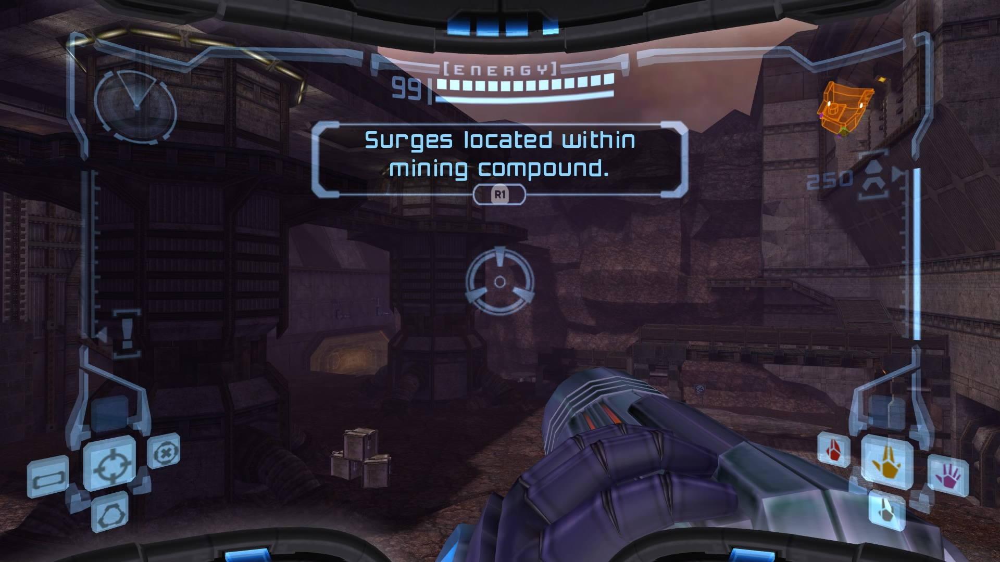

# Metroid Prime PS4 — Original HD

Experience Tallon IV in 1080p on PlayStation 4.

A native PS4 port based on **[PrimeDecomp](https://github.com/PrimeDecomp)** and **[Odrannnn’s MetroidPrimePort](https://github.com/timehikari/metroidprimeport)**.

**[Download 1.0](https://github.com/odiecay/metroid-prime-ps4/releases/download/v1.0/Metroid-Prime-PS4-1.0.zip)** · [Release notes](https://github.com/odiecay/metroid-prime-ps4/releases/tag/v1.0) · [Installation](docs/INSTALLING.md) · [Controls](docs/CONTROLS.md)

The download includes the PS4 PKG and Windows GamePrep helper. Requires a homebrew-enabled PS4 and your own GameCube game dump.

## Features

- Native 1920×1080 rendering and widescreen HUD.
- DualShock 4 controls, vibration and PlayStation button prompts.
- Original-style and modern control presets, with twin-stick aiming.
- Sharper menu lettering and 1.5× menu movies.
- Native audio, persistent saves, shader caching and PS4 renderer optimisations.

Targets 60 FPS; demanding areas can drop below it. [PS4 Slim benchmarks](docs/PERFORMANCE.md).

## Installation

1. Install `PS4/Metroid-Prime-PS4-1.0.pkg`.
2. Use `GamePrep/GamePrep.exe` to prepare your RVZ, ISO, GCM or ZIP. A raw ISO/GCM can also be used directly.
3. Copy the image to `/data/project-prime/data/MetroidPrime.iso` and launch the game.

[Supported versions and full setup](docs/INSTALLING.md).

## Screenshots

| Title screen | Native port settings |
|---|---|
|  |  |

| Save selection | Inventory |
|---|---|
|  |  |

| Chozo Ruins | Magmoor Caverns |
|---|---|
|  |  |

| Lava channel | Phazon Mines |
|---|---|
|  |  |

## Source

[PS4 backend](platform/ps4/) · [Renderer integration](renderer/orbis/) · [Game and Aurora changes](patches/MetroidPrimePort.patch) · [Build instructions](docs/BUILDING.md)

The game and dependencies are fetched at pinned revisions by [bootstrap.py](tools/bootstrap.py). [Architecture and implementation](docs/TECHNICAL.md).

## Credits

**PrimeDecomp** — original game decompilation. **Odrannnn and the MetroidPrimePort contributors** — native-port foundation.

Built with [Aurora](https://github.com/encounter/aurora), [Dawn/WebGPU](https://github.com/google/dawn), [Mesa RADV](https://docs.mesa3d.org/drivers/radv.html), [orbis-ports](https://github.com/orbis-ports), [OpenOrbis](https://github.com/OpenOrbis/OpenOrbis-PS4-Toolchain), [orbis-compat](https://github.com/orbis-ports/orbis-compat), [LLVM](https://llvm.org/), [SDL](https://github.com/libsdl-org/SDL), [MusyX](https://github.com/AxioDL/musyx) and [nod](https://github.com/encounter/nod).

Original game by Nintendo and Retro Studios. Unofficial homebrew project, unaffiliated with Nintendo, Retro Studios or Sony. [Licences and notices](NOTICE.md).
