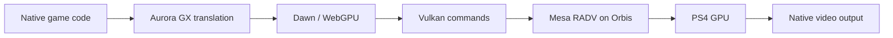

# How Metroid Prime runs on PS4

The starting point was simple: I had never played Metroid Prime, and wanted to
play it on my PS4. Getting there meant taking an existing native game port and
making its whole stack work on Orbis: the game, renderer, audio, controller,
storage and application package.

The result keeps the original game and Aurora engine. This page explains how
the pieces fit together, where the PS4-specific work lives, and why performance
depends on more than the GPU. For measured results, see
[Performance Benchmarks](PERFORMANCE.md).

## From decompilation to a native game

[PrimeDecomp](https://github.com/PrimeDecomp) reconstructed the original game
through reverse engineering and decompilation. Odrannnn and the MetroidPrimePort
contributors built on that work to run the game natively on modern hardware.
Project Prime adapts that foundation to PS4.

The game code is compiled for the PS4's x86-64 CPU. There is no Dolphin process
or emulated GameCube CPU underneath it. The game still uses many of its
original interfaces; Aurora provides source-level compatibility for those
interfaces and translates the rendering work into modern graphics APIs.

That distinction matters. Native execution removes the need to emulate the
original machine, but the game's draw calls, resource preparation and
synchronisation still have to be efficient on PS4 hardware.

## Following a frame

**The game** updates the world and records the original GX rendering work.
**Aurora** decodes that work, prepares geometry and uniforms, resolves pipeline
state and records WebGPU rendering. **Dawn** implements WebGPU and translates
its commands and shaders for Vulkan. **Mesa RADV**, with the orbis-ports PS4
adaptation and this port's integration changes, produces the GPU command stream.
Native video output presents the finished image.

Aurora, Dawn and RADV were not created for this project. The work here adapts
their existing machinery to Orbis and the game's workload. The exported patches
record those changes against pinned upstream revisions.

### Rendering and presentation

Auto mode renders gameplay at the surface resolution, 1920×1080 on the tested
configuration. That is the internal game framebuffer as well as the output
size, rather than a claim based only on the television's input mode. Resolution
and other graphics options remain adjustable. The recorded hardware benchmark
uses scale 1 with dynamic resolution disabled.

Dawn's Vulkan backend connects to the native RADV driver through its static
entry point. The PS4 surface integration selects the pinned driver's
`VK_EXT_headless_surface` interface. In this Orbis implementation it reaches
the native window-system integration and `sceVideoOut`, including real buffer
registration and flips. The extension name does not mean the game renders to
an offscreen desktop window.

SDL supplies logical window geometry and events. Aurora and Dawn render the
image; native WSI manages presentation. A submitted frame, a completed GPU job
and a display buffer that is safe to reuse are separate events.

### Keeping the work moving

The main game thread, FIFO decoder and render worker can overlap their work.
The decoder prepares the recorded GX stream while the render worker encodes
and submits frames. The two-frame CPU ownership scheme keeps recording storage
alive until the consumer has finished with it. GPU resources and displayed
images have their own completion and retirement rules.

This is why simply adding the thread timings gives the wrong answer. A main
thread waiting on the FIFO can overlap CPU work on the decoder. The GPU can be
executing one frame while the CPU prepares another. A wait is elapsed time, but
it is not necessarily time spent executing on that CPU core.

The presentation prewait arranges back-pressure around available video-output
slots. It helps control when work reaches presentation without allowing storage
still owned by a consumer to be recycled. Its hardware comparison is discussed
in [the performance guide](PERFORMANCE.md#consistency-matters-as-well-as-average-fps).

## Where the optimisation work went

On PS4's Jaguar CPU, the cost of preparing thousands of small pieces of
rendering work can matter as much as the GCN GPU's drawing time. Testing has
guided several kinds of changes:

- **Batching preparation and reusing state.** Compatible primitive preparation,
  command storage, pipeline state and bindings can avoid repeated setup without
  changing what the game draws.
- **Reducing copies and uploads.** Resident-array reuse and fewer repeated
  shader-constant uploads cut preparation work. The 1.0 source retains
  bounded small geometry copies, with the SDK copy path for larger data.
- **Cheaper synchronisation.** Native FIFO wake channels and explicit frame
  ownership let the workers coordinate without discarding the lifetime rules
  that keep asynchronous rendering correct.
- **Shader and pipeline caching.** Previously prepared work can be reused.
  The benchmark waits for compilation to settle so a steady-scene comparison
  does not accidentally measure different first-use workloads.
- **Driver integration.** The RADV command-buffer overlay is built from pinned
  source with the PS4's supported instruction set. It is checked against the
  original SDK object before applying the CPU-specific tuning.
- **Keeping diagnostics proportional.** Detailed per-call timing is useful for
  finding costs, but adds work of its own. The 1.0 source disables
  that extra sampling for normal play while retaining frame summaries.

These are implementation changes, not a list of promised FPS gains. Some
comparisons show an improvement, some are essentially flat, and some
experiments were not retained. [The measurements](PERFORMANCE.md#what-changed-across-builds)
keep those outcomes visible.

## Making it feel like a PS4 game

The native `scePad` bridge feeds SDL gamepad events into the existing input
system. That preserves the port's original-style and modern presets, twin-stick
aim and remapping, with PlayStation button prompts and DualShock 4 vibration.
Options pauses the game; holding the touchpad opens the settings panel.
Everything needed for ordinary play is accessible from the controller.

Fullscreen menus use the original movie backgrounds, prepared at 1.5×
(960×720). The distance-field font preserves original glyph layout while
sharpening lettering. Its Deface font is converted from user-supplied
Metroid Prime Remastered data; gameplay retains the original GameCube models,
textures and worlds. Linear R8 menu-video planes upload one byte per texel
instead of four, reducing those upload bytes by 75%; this is a data-size
reduction, not a measured PS4 frame-rate gain. The Options screen includes a 3D PS4 model
using the menu's lighting and animation. These are part of the PS4 adaptation;
Original HD gameplay retains the GameCube models, textures, worlds and effects.

MusyX provides the game audio mixer. SDL's Orbis audio backend passes the mixed
audio to the native output service as 48 kHz stereo blocks. Graphics timing,
audio delivery and controller response have separate paths; a rendering
benchmark alone cannot certify all three.

## Your disc, saves and settings

GamePrep runs on the PC. It checks the supplied image, converts RVZ or extracts
a supported image from ZIP, and writes `MetroidPrime.iso` with an import receipt.
The PS4 reads that raw image directly. There is no game download or texture-pack
extraction step in the player setup.

The native reader implements the nod interfaces used by Aurora. Shared
ownership keeps the image open while disc, partition and file handles need it;
locking protects seeks and independent file positions. The PC conversion tools
and nod's upstream work are credited separately from this native reader adapter.

| Content | Console path |
|---|---|
| User-supplied game image | `/data/project-prime/data/MetroidPrime.iso` |
| Saves and settings | `/data/project-prime/release/user/` |
| Disposable shader caches | `/data/project-prime/release/cache/` |
| Logs | `/data/project-prime/release/logs/` |

These paths live outside the installed application package, so an application
update does not replace the save directory. Keep `user/` when updating or
clearing caches. Benchmark workloads use their own directories and assisted
state; they are not evidence that an ordinary save has completed the game.

## Building for Orbis

This is a cross-compiled native application, using a pinned LLVM toolchain,
C++ runtime, Orbis compatibility layer and Mesa inputs. The target's ABI,
threading, TLS, loader layout and supported CPU instructions must agree across
the whole link. A successful desktop build cannot substitute for that work.

The repository contains the PS4 backend and patches, rather than duplicate
copies of every upstream tree. Bootstrap retrieves the revisions in
[`upstream.lock.json`](../upstream.lock.json). The
[source guide](SOURCE.md) explains provenance and the
[build guide](BUILDING.md) gives the commands.

Package verification checks the native executable, constructs the PKG and
reads it back independently. That proves package structure and identity.
Hardware captures then establish what the console actually ran. The
[benchmark methodology](PERFORMANCE.md#method-and-evidence) keeps those stages
separate from complete-game or release acceptance.

The original game belongs to Nintendo and Retro Studios. Upstream projects
retain their own licences and notices; see [NOTICE.md](../NOTICE.md) and
[LICENSES/](../LICENSES/).
